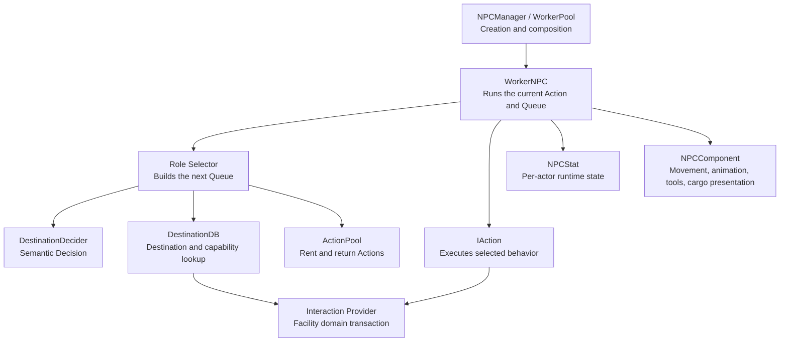
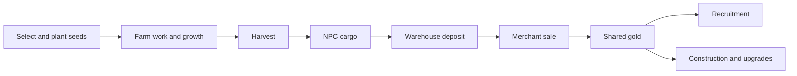

# Project N

> **Work in Progress** · A Unity 2D settlement management game built around autonomous NPCs

**English** | [한국어](README.md)

Project N is a solo portfolio project about managing a small settlement whose residents make decisions and work autonomously. Players shape production and daily life through role-specific recruitment, crop selection, facility construction, and housing expansion while preparing for raids.

The intended experience is to observe how work, needs, housing, and combat affect the next action, without issuing every movement or task directly.

## Overview

| Item | Details |
|---|---|
| Genre | 2D settlement management and autonomous NPC simulation |
| Development | Solo portfolio project |
| Engine | Unity `6000.3.9f1` |
| Core technologies | C#, Utility AI, action queues, A* pathfinding, object pooling, ScriptableObjects, CSV |
| Implemented scope | Feature implementations and scene wiring for farming, logistics, trading, recruitment, construction, housing, and wall defense |
| Main remaining work | Integrated play checks, balance tuning, UI improvements and integration |

This introduction reflects the repository as of **2026-10-17**. Features have different scene integrations and verification coverage. An implemented feature does not establish completion of the game or a development phase.

## Implemented Gameplay

| Area | Current implementation | Documentation |
|---|---|---|
| Autonomous behavior | Utility evaluation, role-specific queues, work, food, drink, sleep, and wandering | [Decisions and Actions](PublicMD/Systems/NPC_Decision_and_Actions/README.md) |
| Farming and logistics | Carrot/Potato seed selection and planting, growth, harvesting, NPC cargo, and warehouse deposits | [Farming](PublicMD/Systems/Farming/README.md) |
| Resources and trade | Shared quantities and storage capacity, visiting merchant sales UI, combined item debit and gold credit | [Resources](PublicMD/Systems/Inventory_and_Items/README.md) · [Merchant](PublicMD/Systems/Merchant_Caravan.md) |
| Recruitment | Farmers, guards, and builders with independent costs, cooldowns, and reserved spawning; archers in the Defense scene | [Town Hall](PublicMD/Systems/Town_Hall.md) |
| Construction | Designated plots, selection, payment/cancellation, builder reservations, work, completion, and staged visuals | [Construction](PublicMD/Systems/Construction/README.md) |
| Housing and daily life | Four housing tiers, automatic assignment, home/inn recovery, upgrades, dissatisfaction, and work strikes | [Housing](PublicMD/Systems/Housing/README.md) · [Dissatisfaction](PublicMD/Systems/NPC_Dissatisfaction.md) |
| Wall defense | Swordsman and archer pursuit/combat, wall damage and passage changes, civilian fleeing, downed actors, repairs, rebuilding, and rubble clearance | [Combat](PublicMD/Systems/Combat/README.md) · [Defense](PublicMD/Systems/Defense/README.md) |
| Waves and events | Preparation/raid phases, enemy spawning, event choices, pause, and game over when the town hall is destroyed | [Defense Progression](PublicMD/Systems/Defense/Progression.md) |
| Observation and UI | Facility popups, stock/gold displays, farm gauges, thought bubbles, and localization infrastructure | [UI](PublicMD/Systems/UI.md) · [NPC Messages](PublicMD/Systems/NPC_Messages.md) |

Code and wiring exist for these features; play and visual verification across every scene and scenario is still incomplete. Actual checks, user confirmations, and remaining coverage are recorded in [Progress](PublicMD/Status/PROGRESS.md) and the owning feature documents.

## Running the Project

1. Clone the repository.
2. Open it in Unity Hub with Unity **6000.3.9f1** and wait for package and asset imports.
3. Open one of the scenes below and enter Play Mode.

| Scene | Purpose |
|---|---|
| [DefenseTest](Assets/Scenes/DefenseTest.unity) | Construction/housing settlement extended with walls, soldiers, raid waves, and events |
| [BuildingTest](Assets/Scenes/BuildingTest.unity) | Designated plots, builder work, resources, housing assignment, and upgrades |
| [FarmerTest](Assets/Scenes/FarmerTest.unity) | Farmer decisions, needs, seed selection, production, and hauling |
| [GuardTest](Assets/Scenes/GuardTest.unity) | Basic guard/enemy combat |
| [LocalizeTest](Assets/Scenes/LocalizeTest.unity) | CSV localization with Text/TMP displays |

Start with `DefenseTest` to explore multiple connected systems, or `FarmerTest` for the basic farming flow. The current [Build Settings](ProjectSettings/EditorBuildSettings.asset) register `FarmerTest`.

In `FarmerTest` and `BuildingTest`, arrow keys move the camera and the mouse wheel zooms. Clicking wired facilities or plots opens their popups. Wheel input over UI is reserved for UI scrolling.

## UI Refresh

Alongside the existing gameplay popups, WarmPixel prefabs use cream surfaces, brown pixel borders, and green buttons.

- [Merchant popup](Assets/Prefab/UI/WarmPixelMerchantPopup.prefab): product list, quantity controls, sales breakdown, and total
- [Town hall popup](Assets/Prefab/UI/WarmPixelTownHallPopup.prefab): role list on the left, character/details on the right, and a recruitment area below

These are **presentation prefabs for reviewing layout and appearance**. Place them under a Canvas to inspect them. They do not replace the wired sales/recruitment UI in existing scenes. Trading, recruitment, and role switching still need integration; the new town hall's stat values remain `—` placeholders. Its resident and tool images reuse existing game sprites.

## Design Highlights

### Decision and Execution Ownership



`DestinationDecider` compares state, travel time, action cost/risk, and predicted outcomes in a Utility model. It supports bounded look-ahead of up to three levels; role selectors translate decisions into action queues. Role-specific selectors and policies handle priorities such as combat responses and construction reservations.

`WorkerNPC` owns queue lifecycle, while actions own execution, completion, failure, and replanning. Returning actions to their pool clears references and timers. Providers own facility resource mutations and reservations.

### Product Movement and Resource Transactions



Products travel through capacity-limited NPC cargo into storage. Partial deposits subtract only the transferred quantity and preserve rejected cargo. Gold is another shared resource item. Sales validate and apply item debits and gold credits together through `ResourceManager.TryExchange`.

### Pathfinding and a Changing Battlefield

Tilemap grids and A* with a binary min-heap account for terrain costs, building entrances, and blocked areas. In the defense scene, wall destruction and rebuilding change passages and trigger path updates. Combat targets, health, construction progress, and presentation state have separate owners.

### Data and Presentation

| Type | Responsibility |
|---|---|
| CSV | Items, construction costs, housing tiers/effects, and localized text |
| ScriptableObjects | Shared definitions, role stats, crop/decision/wave tuning |
| C# runtime objects | Per-NPC stats, targets, cargo, and resident state |
| Scene components | Farm progress, shared resources, facilities, housing, and battlefield state |
| Presentation components | Animation, sprites, tools, cargo, and speech bubbles |

## Technology and Structure

The engine version is recorded in [ProjectVersion.txt](ProjectSettings/ProjectVersion.txt); package versions are in [manifest.json](Packages/manifest.json).

- Unity `6000.3.9f1` / C#
- Universal Render Pipeline 2D `17.3.0`
- Unity Input System `1.18.0` / uGUI `2.0.0`
- Animator, DOTween, Unity Object Pooling
- ScriptableObjects, CSV, pixel sprites, and 9-slice UI

```text
Assets/
├─ Scripts/          Actors, managers, actions, selectors, UI, shared contracts
├─ Data/             Structs, CSV, ScriptableObject definitions and settings
├─ Art/Generated/    Buildings, NPCs, crops, defense, and UI assets
├─ Prefab/           Residents, facilities, crops, and UI prefabs
├─ Scenes/           Feature test scenes
├─ Editor/           Editor tools and development harness
└─ TestOnly/         Development/check code and test-scene support

PublicMD/
├─ Systems/          Current feature architecture and ownership
├─ Plans/            Active implementation plans
├─ Status/           Implementation, verification, and review history
└─ Archive/          Completed or superseded plans
```

## Remaining Work and Documentation

Integrated play checks, balance tuning, and gameplay integration of the new UI remain. Merchant buying, resident experience/progression, healing/reviving downed residents, victory conditions, and save/load are outside the currently completed implementation scope.

Phase A–D goals and exit criteria remain in the [Development Plan](PublicMD/PLAN.md). Approved construction, housing, and defense slices are tracked separately from overall phase completion. Historical builds and individual user confirmations are not presented as current verification of the entire repository.

- [Documentation Guide](PublicMD/README.md) — task-specific reading routes
- [Game Plan](PublicMD/Game_Plan.md) — vision and scope
- [Architecture](PublicMD/ARCHITECTURE.md) — shared ownership and dependency direction
- [Project Structure](PublicMD/ProjectStructure.md) — folder ownership and feature map
- [Systems](PublicMD/Systems/README.md) — implementation details by feature
- [Progress](PublicMD/Status/PROGRESS.md) — executed checks, user confirmations, and unverified coverage

## Development Process and AI Assistance

AI tools support planning, implementation, code review, and selected visual asset generation. Final requirements, architecture decisions, Unity integration, testing, and project management remain the developer's responsibility. Generated pixel UI assets are also refined manually in Aseprite.
