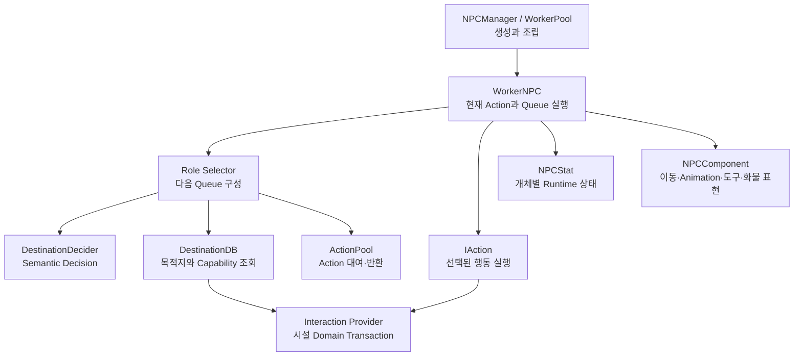
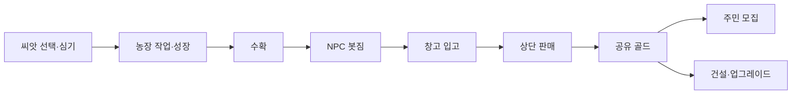

# Project N

> **Work in Progress** · Unity 2D 자율 NPC 정착지 운영 게임

[English](README.en.md) | **한국어**

Project N은 주민들이 스스로 판단하고 일하는 작은 마을을 운영하는 1인 개발 포트폴리오 프로젝트입니다. 플레이어는 직군별 주민 모집, 작물 선택, 시설 건설과 주택 확장을 통해 마을의 생산과 생활을 조정하고, 습격에 대비합니다.

주민의 이동과 행동을 매 순간 직접 명령하는 대신, 업무·생활 욕구·주거·전투 상황이 다음 행동에 어떻게 영향을 주는지 관찰하는 경험을 목표로 합니다.

## 프로젝트 개요

| 항목 | 내용 |
|---|---|
| 장르 | 2D 정착지 운영·자율 NPC 시뮬레이션 |
| 개발 형태 | 1인 개발, 포트폴리오 프로젝트 |
| 엔진 | Unity `6000.3.9f1` |
| 핵심 기술 | C#, Utility AI, Action Queue, A* 경로 탐색, Object Pooling, ScriptableObject, CSV |
| 현재 범위 | 농사·물류·거래·모집·건설·주거·성벽 방어의 기능별 구현과 씬 연결 |
| 남은 주요 작업 | 통합 플레이 확인, 밸런스 조정과 UI 개선·연결 |

이 README는 **2026-10-17 저장소 기준** 소개입니다. 기능마다 적용 씬과 검증 범위가 다르며, 개별 기능 구현을 전체 게임이나 개발 Phase의 완료로 계산하지 않습니다.

## 구현된 플레이 요소

| 영역 | 현재 구현 | 상세 문서 |
|---|---|---|
| 자율 행동 | Utility 판단, 직군별 queue 구성, 업무·식사·음료·수면·배회 | [판단과 Action](PublicMD/Systems/NPC_Decision_and_Actions/README.md) |
| 농사와 물류 | 당근·감자 씨앗 선택·심기, 성장·수확, NPC 봇짐 운반과 창고 입고 | [농사](PublicMD/Systems/Farming/README.md) |
| 자원과 거래 | 공유 수량·창고 용량, 방문 상단의 판매 UI, 물품 차감·골드 지급의 일괄 처리 | [자원](PublicMD/Systems/Inventory_and_Items/README.md) · [상단](PublicMD/Systems/Merchant_Caravan.md) |
| 주민 모집 | 농부·경비병·건축가의 독립 비용·쿨다운·예약 스폰; Defense 씬은 궁병 추가 | [시청](PublicMD/Systems/Town_Hall.md) |
| 건설 | 지정 부지의 시설 선택·지불·취소, 건축가 예약·작업·완공과 공사 단계 표현 | [건설](PublicMD/Systems/Construction/README.md) |
| 주거와 생활 | 주택 1~4단계, 자동 입주, 집·여관 회복, 업그레이드와 불만도·태업 | [주거](PublicMD/Systems/Housing/README.md) · [불만도](PublicMD/Systems/NPC_Dissatisfaction.md) |
| 성벽 방어 | 검객·궁병의 적 추적과 전투, 성벽 손상·통로 변화, 주민 도주·쓰러짐, 수리·재건·잔해 제거 | [전투](PublicMD/Systems/Combat/README.md) · [방어](PublicMD/Systems/Defense/README.md) |
| 웨이브와 사건 | 정비·습격 전환, 적 생성, 이벤트 선택, 일시정지와 시청 파괴 시 게임 종료 | [방어 진행](PublicMD/Systems/Defense/Progression.md) |
| 관찰과 UI | 시설 팝업, 재고·골드 표시, 농장 게이지, 주민 생각 말풍선과 지역화 기반 | [UI](PublicMD/Systems/UI.md) · [주민 메시지](PublicMD/Systems/NPC_Messages.md) |

각 기능의 코드와 배선은 존재하지만, 모든 씬·상황의 플레이와 화면 검증이 끝난 상태는 아닙니다. 검사 결과, 사용자 확인과 남은 항목은 [진행 기록](PublicMD/Status/PROGRESS.md)과 각 기능 문서에서 관리합니다.

## 실행 방법과 테스트 씬

1. 저장소를 clone합니다.
2. Unity Hub에서 Unity **6000.3.9f1**로 프로젝트를 열고 패키지와 에셋 import를 기다립니다.
3. 아래에서 살펴볼 씬을 열고 Play Mode를 실행합니다.

| 씬 | 용도 |
|---|---|
| [DefenseTest](Assets/Scenes/DefenseTest.unity) | 건설·주거 기반 마을에 성벽·병사·습격 웨이브·이벤트를 연결한 방어 씬 |
| [BuildingTest](Assets/Scenes/BuildingTest.unity) | 지정 부지 건설, 건축가 작업, 자원과 주택·입주·업그레이드 |
| [FarmerTest](Assets/Scenes/FarmerTest.unity) | 농부의 판단·생활·씨앗 선택·생산·운반 흐름 |
| [GuardTest](Assets/Scenes/GuardTest.unity) | 경비병·적의 기본 전투 확인 |
| [LocalizeTest](Assets/Scenes/LocalizeTest.unity) | CSV 문구와 Text/TMP 지역화 표시 확인 |

여러 기능을 함께 살펴보려면 `DefenseTest`, 농부의 기본 흐름부터 보려면 `FarmerTest`에서 시작할 수 있습니다. 현재 [Build Settings](ProjectSettings/EditorBuildSettings.asset)에 등록된 씬은 `FarmerTest`입니다.

`FarmerTest`와 `BuildingTest`에서는 방향키로 카메라를 이동하고 마우스 휠로 확대·축소합니다. 연결된 시설·부지를 클릭하면 해당 팝업이 열립니다. 팝업 위의 휠은 UI 스크롤에 사용됩니다.

## UI 개선 진행

실제 게임에 연결된 기존 팝업과 별도로, 크림색 바탕·갈색 픽셀 테두리·초록 버튼을 사용하는 WarmPixel 프리팹을 제작하고 있습니다.

- [상단 팝업](Assets/Prefab/UI/WarmPixelMerchantPopup.prefab): 상품 목록, 수량 입력, 판매 명세·합계 구성
- [시청 팝업](Assets/Prefab/UI/WarmPixelTownHallPopup.prefab): 왼쪽 직군 목록, 오른쪽 캐릭터·상세 정보, 하단 모집 영역

두 프리팹은 **외형과 배치를 확인하는 표시용 에셋**입니다. Canvas 아래에 배치해 확인하며, 기존 씬의 판매·모집 UI를 대체하지 않습니다. 거래·모집·직군 전환 등의 기능 연결은 후속 작업이고, 새 시청의 능력치 값은 `—` 자리로 남겨 두었습니다. 시청의 주민·도구 이미지는 기존 게임 스프라이트를 재사용합니다.

## 주요 설계

### 판단과 실행의 책임 분리



`DestinationDecider`는 상태, 이동 시간, 행동 비용·위험도와 예상 결과를 Utility 모델로 비교합니다. 최대 3단계의 bounded look-ahead를 지원하고, role selector가 판단 결과를 실행 queue로 구성합니다. 전투 대응과 건설 예약 등 직군별 우선순위는 해당 selector와 정책이 담당합니다.

`WorkerNPC`는 queue lifecycle을, action은 실행·완료·실패·재판단을 소유합니다. action을 pool에 반환할 때 참조와 타이머를 정리하며, 시설의 실제 자원 변경과 예약은 provider가 처리합니다.

### 생산물의 이동과 자원 Transaction



생산물은 NPC의 용량 제한 봇짐을 거쳐 창고에 입고됩니다. 부분 입고 시 실제 이동한 수량만 차감하고, 목적지가 거부한 수량은 보존합니다. 골드도 공용 자원의 한 항목이며, 판매의 물품 차감·골드 지급은 `ResourceManager.TryExchange`로 함께 검증하고 적용합니다.

### 경로 탐색과 동적 전장

Tilemap 기반 그리드와 이진 최소 힙을 사용하는 A*로 지형 비용·건물 출입구·이동 불가 구역을 반영합니다. 방어 씬에서는 성벽의 파괴·재건에 따른 통로 변화가 경로 갱신에 반영됩니다. 전투 target, 체력, 공사 진행과 표현 상태는 각각의 소유 객체로 분리합니다.

### 데이터와 표현 분리

| 종류 | 역할 |
|---|---|
| CSV | 아이템, 건설 비용, 주택 단계·효과와 지역화 문구 |
| ScriptableObject | 공유 정의, 직군 stat, 작물·판단·웨이브 tuning |
| C# runtime 객체 | NPC별 stat, target, 봇짐과 주민 상태 |
| Scene component | 농장 progress, 공유 자원, 시설·주택·전장 상태 |
| Presentation component | Animation, sprite, 도구·화물·말풍선 표시 |

## 기술 스택과 구조

엔진 버전은 [ProjectVersion.txt](ProjectSettings/ProjectVersion.txt), 패키지 버전은 [manifest.json](Packages/manifest.json)을 기준으로 합니다.

- Unity `6000.3.9f1` / C#
- Universal Render Pipeline 2D `17.3.0`
- Unity Input System `1.18.0` / uGUI `2.0.0`
- Animator, DOTween, Unity Object Pooling
- ScriptableObject, CSV, 픽셀 스프라이트와 9-slice UI

```text
Assets/
├─ Scripts/          Actor·Manager·Action·Selector·UI·공통 계약
├─ Data/             Struct·CSV·ScriptableObject 정의와 설정
├─ Art/Generated/    건물·NPC·작물·방어·UI 에셋
├─ Prefab/           주민·시설·작물·UI 프리팹
├─ Scenes/           기능별 테스트 씬
├─ Editor/           Editor 도구와 작업 하네스
└─ TestOnly/         개발·검증용 코드와 테스트 씬 보조

PublicMD/
├─ Systems/          기능별 현재 구조와 책임
├─ Plans/            활성 상세 구현 계획
├─ Status/           구현·검증·코드 검토 이력
└─ Archive/          완료되거나 대체된 계획
```

## 남은 작업과 문서

통합 플레이 확인, 임시 밸런스 조정과 새 UI의 실제 기능 연결이 남아 있습니다. 상단 구매, 주민 경험치·성장, 쓰러진 주민의 치료·회복, 승리 조건, 저장·불러오기 등은 현재 구현 완료 범위에 포함하지 않습니다.

Phase A~D의 목표와 종료 조건은 [개발 계획](PublicMD/PLAN.md)을 따릅니다. 승인된 건설·주거·방어 등 선행 slice의 구현과 전체 Phase 완료 판정은 구분합니다. 과거 빌드나 일부 사용자 확인을 현재 저장소 전체의 검증 결과로 표시하지 않습니다.

- [문서 안내](PublicMD/README.md) — 작업별 문서 읽기 경로
- [Game Plan](PublicMD/Game_Plan.md) — 게임 비전과 범위
- [Architecture](PublicMD/ARCHITECTURE.md) — 공통 책임과 의존 방향
- [Project Structure](PublicMD/ProjectStructure.md) — 폴더 책임과 기능 문서 지도
- [Systems](PublicMD/Systems/README.md) — 기능별 상세 구현
- [Progress](PublicMD/Status/PROGRESS.md) — 실행한 검사, 사용자 확인과 미검증 사항

## 개발 방식과 AI 활용

기획 정리, 구현 보조, 코드 검토와 일부 시각 에셋 생성에 AI 도구를 활용합니다. 최종 요구사항, 아키텍처 판단, Unity 통합, 테스트와 프로젝트 관리는 개발자가 담당합니다. 생성한 픽셀 UI 에셋은 Aseprite에서 직접 수정하며 스타일을 다듬고 있습니다.
